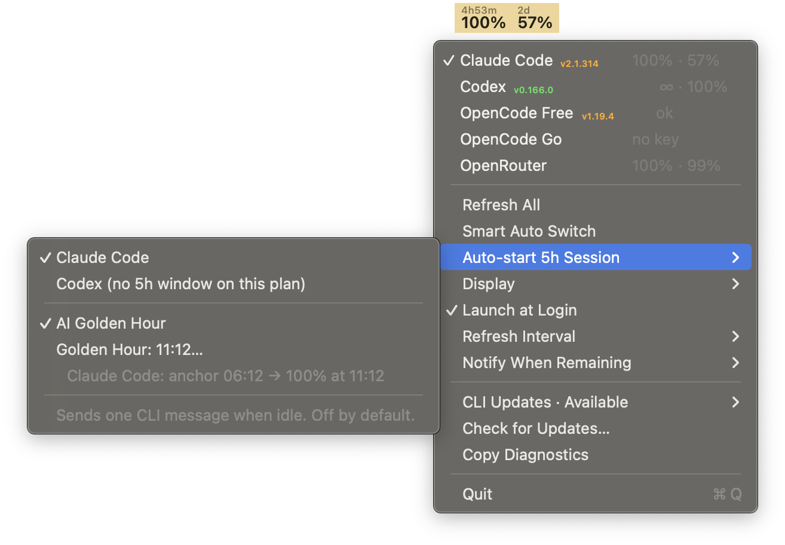
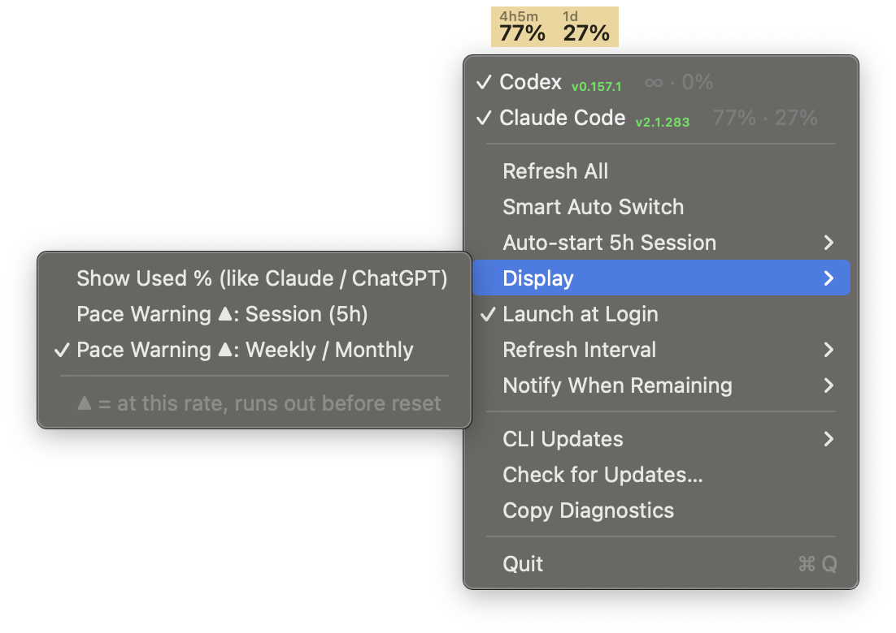

<p align="center">
  
</p>

<h1 align="center">ClaudexBar</h1>

<p align="center">
  Claude Code, Codex, OpenRouter &amp; OpenCode usage limits in your macOS menu bar — native, dependency-free, nothing to configure.
</p>

<p align="center">
  <a href="https://github.com/l0bz1k/claudexbar/actions/workflows/ci.yml"></a>
  <a href="LICENSE"></a>
  
</p>

> **This is an extended fork** of [ipangdz/claudexbar](https://github.com/ipangdz/claudexbar).
> Grab the latest build from [Releases](https://github.com/l0bz1k/claudexbar/releases) — the app then keeps itself up to date.

A small native macOS menu-bar app that shows how much of your AI coding limits is left, at a glance: the session and weekly windows of **Claude Code** and **Codex**, the free-model quota and credit balance of **OpenRouter**, and the limits of **OpenCode Go** and opencode's free tier. It reuses the logins you already have — no API keys to paste, no browser cookies, no dependencies — and it can time your session windows so a fresh one starts exactly when you need it.

## Screenshots

<p align="center">
  <br>
  <br>
  <em>Usage right in the menu bar — click to cycle providers, right-click for the menu, hold ⌥ Option for re-auth.</em>
</p>

## Providers

| Provider | What it shows | Where the data comes from |
|---|---|---|
| **Claude Code** | 5-hour session · weekly limit | Claude's usage endpoint, with ClaudexBar's own sign-in (or Claude Code's login, read-only) |
| **Codex** | 5-hour session · weekly limit (or the 30-day quota on the ChatGPT Go plan) | ChatGPT's usage endpoint, with Codex's login from `~/.codex/auth.json` |
| **OpenRouter** | free-model requests left today · credit balance (or the key's own spending limit) | OpenRouter's API, with the key opencode stores |
| **OpenCode Go** | 5-hour limit · the tighter of the weekly/monthly limits (all three in the tooltip) | the official `opencode.ai/zen/go/v1/usage` endpoint, with your Go key |
| **OpenCode Free** | `ok`, or `0%` with a countdown while the free tier is blocked | opencode's local database (read-only, no network) — see below |

The OpenRouter and OpenCode keys are read from opencode's own store (`~/.local/share/opencode/auth.json`) or from `OPENROUTER_API_KEY` / `OPENCODE_API_KEY`, so if opencode works, ClaudexBar does too. A provider with nothing configured shows `no key`.

**About OpenCode Free:** opencode's free models have no usage API — the server only says *"Free usage limit reached"* (HTTP 429 with `Retry-After`) when it refuses a request. opencode saves that response, so ClaudexBar reads the latest one and counts down to the reset. How much free usage is left before that point is never reported, so it shows `ok` rather than an invented percentage.

## Features

**Menu bar and menu**
- The tray shows one provider at a time: left-click cycles through the providers **checked** in the menu, or let **Smart Auto Switch** follow the one you're actually using.
- The menu always shows **current limits for every provider** — all of them are polled in the background, checked or not. Figures are lined up in columns: session values under session values, weekly under weekly.
- Each CLI's installed version is shown next to its name — green when current, orange when an update exists.
- **Display** options: show *used* % (as the Claude and ChatGPT apps do) instead of remaining %, and a **pace warning ▲** per window — at the rate you've been using it, that limit runs out before it resets.
- Hover the icon for a plain-language breakdown: each window, when it resets, and the pace projection behind any ▲.
- Transparent template icon that matches the rest of the menu bar, only as wide as its text.

**Auto-start 5h Session** (opt-in, per provider)
- A session window only starts with your first message. If a fresh window sits idle while you're away, ClaudexBar sends one trivial message through the real `claude`/`codex` CLI so its clock starts — and the next reset comes sooner.
- It acts right after a known reset, even during a brief Power Nap wake with the lid closed, and keeps the Mac awake for the few seconds the message takes.
- Safety rails: one attempt per window, a daily cap, retry with backoff when the network fails, and a circuit breaker (with a notification) if anchoring stops working, which re-arms itself after 24 hours.

**AI Golden Hour** (opt-in)
- Pick a time of day — every day at that time, your session windows reset to **100%**. A window resets a fixed time after it starts, so ClaudexBar anchors it that much earlier (09:00 for a 14:00 golden hour with 5-hour windows).
- Windows that fit before then start as usual; only the one that would still be running at the anchor time is held until it. Works for any window length.
- If you're already working at the anchor time, you get one notification that today's golden hour isn't reachable, and the regular schedule continues until tomorrow.
- Tip: choose a time on a 10-minute mark (14:00, 14:10) — Claude rounds a window's start to 10 minutes.

**Updates**
- **The app updates itself:** it checks this fork's releases daily and shows **⬆ Update to x.y.z…** at the top of the menu. One click downloads it, verifies the published SHA-256, checks the version and signature, swaps the app (restoring the old one if anything fails) and relaunches.
- **CLI Updates:** check which CLIs ClaudexBar may update — Codex, Claude Code (on by default) and opencode (off by default, since its releases include major-version jumps). **Update Selected CLIs Now** and the optional **Daily Auto-update** only touch the checked ones.

**Notifications and troubleshooting**
- Optional notification when the shown provider's remaining usage drops below a threshold, and when a window comes back to 100%.
- Clear status words instead of a generic error — see [Status words](#status-words).
- **Copy Diagnostics** puts a redacted report (versions, settings, every provider's last answer, the log tail) on the clipboard, ready for a bug report.
- No telemetry or analytics. Logs are scrubbed of anything token-shaped and rotated at 1 MB.

## Install

Works on **both Apple Silicon and Intel** Macs (macOS 13+).

1. Download `ClaudexBar.zip` from [Releases](https://github.com/l0bz1k/claudexbar/releases/latest).
2. Unzip it and move `ClaudexBar.app` to `/Applications` (or `~/Applications`).
3. Open it. It isn't notarized (no Apple Developer ID), so Gatekeeper will refuse to launch it normally the first time — **right-click the app → Open → Open** to confirm you trust it. You only need to do this once.
4. Optional: turn on **Launch at Login** from its menu.

**After installing or updating, macOS asks once for Keychain access** ("ClaudexBar wants to use your confidential information…") — click **Always Allow**. Because the app is ad-hoc signed rather than signed with a Developer ID, macOS ties that permission to the exact build, so it asks again after each update. Until you answer, Claude Code shows `wait`.

From then on the app updates itself (see **Updates** above). To update by hand instead, download the new release and repeat steps 1–2.

The app is a menu-bar accessory (`LSUIElement`), so its icon appears in Finder/Spotlight rather than the Dock.

## Uninstall

1. Quit ClaudexBar (right-click the menu-bar icon → **Quit**, or select it and press `⌘Q`).
2. Move `ClaudexBar.app` to the Trash.
3. If you had turned on **Launch at Login** or **Daily Auto-update**, remove their LaunchAgents:
   ```bash
   launchctl bootout "gui/$(id -u)" ~/Library/LaunchAgents/com.ipang.claudexbar.plist 2>/dev/null
   rm -f ~/Library/LaunchAgents/com.ipang.claudexbar.plist ~/Library/LaunchAgents/com.ipang.claudexbar.cli-updater.plist
   ```
4. Optional — remove its settings and logs:
   ```bash
   defaults delete com.ipang.claudexbar 2>/dev/null
   rm -rf ~/Library/Logs/ClaudexBar
   ```

This does not touch the Claude Code, Codex or opencode credentials.

## Usage

**Left-click** the icon to cycle through the checked providers. **Right-click** for the menu:

- **Provider rows** — one per provider, each with its live figures (`session · weekly`, or a status word). Clicking a row toggles its checkmark without closing the menu; the checkmark only decides whether that provider takes part in the tray rotation. With none checked, the tray shows `off`.
- **⌥ Option** reveals the re-auth action for each provider, and swaps **Refresh All** for **Open Logs…**.
- **Refresh All**, **Smart Auto Switch**, **Auto-start 5h Session** (with **AI Golden Hour**), **Display**, **Launch at Login**, **Refresh Interval**, **Notify When Remaining**, **CLI Updates**, **Check for Updates…**, **Copy Diagnostics**.

In the tray, the left column is the session (5-hour) window and the right column is the longer one (weekly, or monthly on some plans); the small label above each figure is the time until that window resets. Session usage also chips away at the weekly budget.

## Status words

| Shown | Meaning | What to do |
|---|---|---|
| `wait` | No data yet (just launched, or a Keychain prompt is waiting) | Answer the Keychain prompt with **Always Allow** |
| `auth` | The login expired or was rejected | ⌥ → **Re-auth** that provider (see below) |
| `no key` | No API key configured for OpenRouter / OpenCode Go | `opencode auth login`, or set `OPENROUTER_API_KEY` / `OPENCODE_API_KEY` |
| `no opencode` | opencode isn't installed or has never run | Install and run opencode once |
| `net` | The service couldn't be reached and there's no earlier data to show | Usually temporary; check your network or proxy |
| `vpn` | Cloudflare blocked your IP (often a VPN/proxy exit) — the tooltip names it | Switch to another proxy node |
| `err` | An unexpected answer from the service | **Copy Diagnostics** and open an issue |

Temporary problems (a rate limit, a network blip) don't replace the figures: the last known values stay on screen, and after an HTTP 429 the next request to that service waits 2, 4, 8… minutes (up to 10). **Refresh All** always goes out immediately.

## Troubleshooting

- `auth` for Codex: run `codex login` (or ⌥ → **Re-auth Codex**).
- `auth` for Claude Code: choose ⌥ → **Re-auth Claude Code**. Your browser opens Claude's sign-in page; approve access, copy the one-time `code#state` string Claude shows, and paste it into the ClaudexBar dialog (it pre-fills from the clipboard when it recognises a code). ClaudexBar exchanges it for its own access + refresh credential, stored in the Keychain as `ClaudexBar-Claude-Credentials`. The code and tokens are never logged.
- Why a paste: Claude's OAuth client doesn't accept a `localhost` redirect, so the code comes back to Claude's own page instead of to the app.
- Why ClaudexBar keeps its own Claude credential: Claude rotates the refresh token on every refresh, so two apps sharing one login knock each other out. ClaudexBar only ever refreshes its own credential; it may *read* Claude Code's login while that's valid, but never refreshes it.
- The OpenRouter and OpenCode Go keys come from opencode: `opencode auth login` adds or replaces them (⌥ → **Re-auth** opens it in Terminal).
- Something else: **Copy Diagnostics** and include the report in an issue.

## Differences from upstream

Beyond the features above, this fork fixes problems found running the original daily:

- Codex on the ChatGPT Go plan no longer shows `err` (its 30-day window is understood).
- Countdowns show minutes (`4h35m`, not `4h`), and the tray text is never clipped.
- No on-disk HTTP cache (a corrupted one used to flood the log), timeouts on every CLI call, refresh after wake, log rotation.
- Unchecking **Launch at Login** no longer quits the app; update checks come from this fork, not upstream.

The full history is in [CHANGELOG.md](CHANGELOG.md).

## Non-goals

- No history graphs.
- No cost estimation.
- No embedded web view: sign-in happens in your real browser.

## Documentation

- [docs/AUTH.md](docs/AUTH.md) — how Codex and Claude Code authentication work, and why.
- [SECURITY.md](SECURITY.md) — security model and how to report a vulnerability.
- [CHANGELOG.md](CHANGELOG.md) — release notes.

## Contributing

Contributions are welcome — see [CONTRIBUTING.md](CONTRIBUTING.md). The app stays dependency-free.

## Credits

All credit for the original design and implementation goes to [ipangdz](https://github.com/ipangdz) — this fork builds its additional providers, scheduling features and fixes on top of that work. If you only need Codex and Claude Code limits, the [original project](https://github.com/ipangdz/claudexbar) is a fine choice too, and worth supporting.

## License

[MIT](LICENSE).
